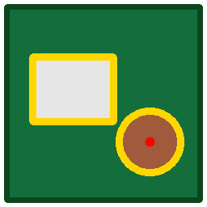

<p align="center"></p>

# BatiScan IA

Extension QGIS de cartographie des bâtiments par intelligence artificielle, pensée pour les villages et quartiers du Sahel (cases rondes, toits en tôle, concessions en banco).

Elle part de ce que l'on a souvent sous la main après une enquête de terrain : un point par bâtiment. Le modèle Segment Anything (SAM) détoure le toit autour de chaque point et produit des polygones d'emprise. Les modèles tournent avec onnxruntime, sans PyTorch ni CUDA à installer.

## Fonctions

| Onglet | Rôle |
|---|---|
| Points → emprises | Une emprise par point de terrain, avec SAM. Les points voisins servent d'exemples négatifs pour ne pas fusionner deux bâtiments. |
| Clic | Un clic au centre d'un toit ajoute son emprise ; clic droit pour annuler. Sert à compléter les points restés sans emprise. |
| Automatique | Détection sans points, sur une emprise, avec le modèle BatiScan Sahel ou tout modèle de segmentation ONNX au format [Deepness](https://qgis-plugin-deepness.readthedocs.io/). |
| Contrôle | Compare points et emprises : taux de couverture, emprises sans point, emprises qui regroupent plusieurs points. |
| Entraînement | Exporte des vignettes image + masque (GeoTIFF) à partir d'emprises vérifiées, pour entraîner un modèle propre à votre zone. |
| Modèles | Téléchargement des modèles, ajout d'un modèle .onnx personnel, choix CPU/GPU. |

L'image peut être un GeoTIFF (orthophoto, drone, Pléiades...) ou un fond XYZ/WMS déjà chargé dans QGIS.

Chaque emprise porte les champs `id_point`, `nb_points`, `methode`, `fiabilite`, `score`, `forme` (rectangle, cercle ou libre), `surface_m2`, `source` et `date`. Le champ `fiabilite` vaut « haute » quand le point tombait sur le toit, « moyenne » quand il a fallu exclure le sol de la vignette, et « faible » quand le toit a été trouvé en cherchant autour du point. Une couche « Points sans emprise » liste les points que l'outil n'a pas su traiter.

## Premiers résultats

Essai sur 300 bâtiments relevés à Dandougou (Mali), avec l'imagerie satellite Google à 0,3 m/pixel et MobileSAM sur un processeur de portable :

- 266 emprises produites, les 26 restantes étant des doublons (deux points sur le même bâtiment) ;
- 289 points sur 300 (96,3 %) couverts par une emprise à moins de 2 m ;
- 0,36 seconde par point en moyenne ;
- 181 emprises de fiabilité haute, 39 moyenne, 46 faible, 8 échecs.

Les emprises de fiabilité faible sont à relire : il arrive qu'elles prennent une cour ou un bout de piste. Le modèle générique « RAMP » de Deepness, essayé sur la même zone, retrouve beaucoup moins de bâtiments (de l'ordre de 12 % des points à 0,5 m/pixel et 45 % à 0,3 m/pixel). D'où l'onglet Entraînement.

## Détection automatique, sans points

L'extension propose le modèle « BatiScan Sahel v2 », qui détecte les bâtiments sur l'image seule. C'est un U-Net (encodeur ResNet-34) à trois classes : fond, intérieur et contour de bâtiment. La classe contour sert à séparer les bâtiments accolés.

Il a été entraîné sur 9 villages du Mali, à 30 cm/pixel :

- 11 277 points relevés sur le terrain à Baba, Dandougou, Dialakoro, Niagassoba et N'jikouna, transformés en emprises par SAM, sur les images Google et Bing ;
- 4 949 polygones produits avec le plugin « AI Segmentation » de TerraLab à Aite, Tiemena, Bourdala et Koffing (confiance de 0,5 ou plus), sur l'image Google. Ces polygones ne contiennent presque pas de cases rondes : les zones où le modèle précédent voyait un bâtiment absent des polygones sont exclues de l'entraînement, pour ne pas apprendre les cases comme du fond.

Le test porte sur Doumanani, un village tenu à l'écart de l'entraînement. La détection n'utilise aucun point ; les 778 points relevés servent seulement à mesurer le résultat.

| Image | Points retrouvés, v2 | v1 (0.2.0) | Durée (village entier, CPU) |
|---|---|---|---|
| Google | 95,0 % | 92,2 % | 18 s |
| Bing | 87,7 % | 75,4 % | 19 s |
| Esri (zoom 17, environ 1,2 m/px) | 84,8 % | 81,2 % | 30 s |

Environ la moitié des emprises détectées contiennent un point relevé. À l'image, une bonne partie des autres sont des bâtiments que le relevé n'a pas comptés (annexes, cuisines, greniers), mais une partie sont des erreurs : ce chiffre ne mesure donc pas exactement la précision.

Sur des zones sans points, v2 détecte mieux que v1 les grands toits (hangars à Koutiala) et le bâti dense en banco (Djenné). Il trace encore parfois le mur d'enceinte d'une concession comme un bâtiment, et les très grands édifices restent incomplets.

Le dossier [`entrainement/`](entrainement/LISEZMOI.md) contient la chaîne complète pour entraîner un modèle sur votre propre zone à partir de vos points.

## Installation

### Depuis le code (pour tester)

1. Cloner le dépôt.
2. Copier ou lier le dossier `batiscan/` dans le dossier des extensions du profil QGIS :
   - Windows : `%APPDATA%\QGIS\QGIS3\profiles\default\python\plugins\`
   - Linux : `~/.local/share/QGIS/QGIS3/profiles/default/python/plugins/`
   - macOS : `~/Library/Application Support/QGIS/QGIS3/profiles/default/python/plugins/`
3. Redémarrer QGIS, puis activer « BatiScan IA » dans Extensions > Installer/Gérer les extensions.

Sous Windows, un lien évite de recopier à chaque modification :

```bat
mklink /J "%APPDATA%\QGIS\QGIS3\profiles\default\python\plugins\batiscan" "C:\chemin\vers\batiscan-qgis\batiscan"
```

### Depuis une archive zip

```bash
python outils/empaqueter.py
```

L'archive `dist/batiscan-<version>.zip` s'installe par Extensions > Installer depuis un ZIP.

### Dépendances

QGIS 3.38 ou plus récent. L'extension a besoin des paquets Python `onnxruntime` et `opencv`. S'ils manquent, elle propose de les installer avec pip à la première ouverture, sans toucher à la version de numpy livrée avec QGIS.

Pour le GPU sous Windows, `onnxruntime-directml` fonctionne avec la plupart des cartes graphiques ; sous Linux, `onnxruntime-gpu` avec CUDA. Sans GPU, tout tourne sur le processeur.

## Utilisation rapide

1. Charger l'image (par exemple un fond satellite XYZ) et la couche de points des bâtiments.
2. Ouvrir BatiScan (menu Raster ou icône de la barre d'outils), onglet « Points → emprises ».
3. Choisir l'image, les points et le modèle MobileSAM. La première fois, l'extension propose de télécharger le modèle (11 Mo).
4. Lancer. Le suivi s'affiche dans la barre des tâches de QGIS, en bas à droite.
5. Relire les emprises de fiabilité faible, compléter les manques avec l'onglet « Clic », puis vérifier avec l'onglet « Contrôle ».

Réglages utiles : la résolution de travail (0,3 m/px convient aux fonds Google et Esri), la taille de vignette (192 px par défaut, soit environ 58 m de côté à 0,3 m/px) et les surfaces minimale et maximale.

## Modèles

| Modèle | Usage | Taille | Licence |
|---|---|---|---|
| MobileSAM quantifié | points et clic | 11 Mo | Apache-2.0 |
| SAM ViT-B quantifié | points et clic, plus précis et plus lent | 75 Mo | Apache-2.0 |
| BatiScan Sahel v2 | détection automatique, bâti rural et bourgs du Sahel | 98 Mo | recherche et tests, non commercial |
| BatiScan Sahel v1 | ancienne version | 98 Mo | recherche et tests, non commercial |
| Bâtiments RAMP (Deepness) | détection automatique, générique | 82 Mo | voir le Model ZOO de Deepness |

Les modèles SAM viennent de [vietanhdev/segment-anything-onnx-models](https://huggingface.co/vietanhdev/segment-anything-onnx-models). Tout modèle de segmentation ONNX contenant les métadonnées Deepness (`model_type`, `class_names`, `resolution`, `tiles_size`, `seg_thresh`...) peut être ajouté depuis l'onglet Modèles.

## Imagerie et usage commercial

Les conditions d'utilisation de Google et d'Esri limitent l'extraction de données à partir de leurs fonds de carte, surtout pour un usage commercial. Pour un travail payant, utiliser une imagerie dont la licence le permet : drone, achat d'images (Pléiades, Maxar...), ou sources ouvertes adaptées.

## Licence

GNU GPL version 2 ou ultérieure (voir `LICENSE`), comme l'exige le dépôt officiel des extensions QGIS.

## Auteur

Allaye GUINDO, géomaticien SIG et télédétection.
